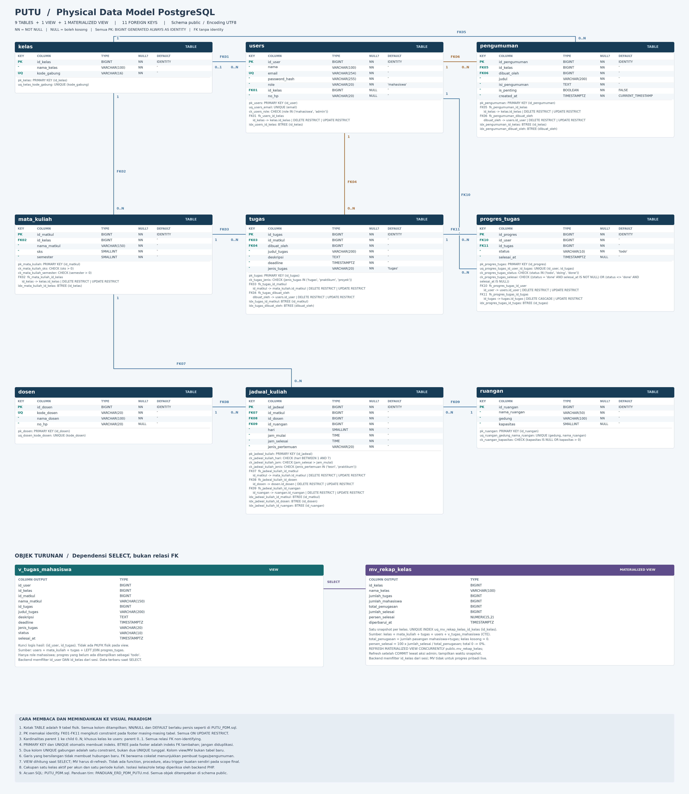

# Panduan ERD dan PDM PUTU untuk Tim

**Rancangan final MVP — 26 Oktober 2026.** Gunakan **9 tabel + 1 view + 1 materialized view** untuk PDM PostgreSQL di Visual Paradigm Desktop. Function buatan sendiri, stored procedure, dan trigger tidak masuk scope final; validasi tetap memakai constraint dan backend PHP. Master dosen dan ruangan tetap dipisah agar dekat dengan ERD awal tim. DDL lengkap tersedia di [PUTU_PDM.sql](PUTU_PDM.sql). Penerapan ke database aplikasi tetap menjadi tahap implementasi tim.

## 1. Aturan aplikasi

- Satu pengguna memiliki **0 atau 1 kelas aktif**; akun baru boleh belum bergabung. Satu kelas memiliki banyak pengguna.
- Role hanya `mahasiswa` dan `admin`. Admin mengelola kelas tempat akunnya tergabung; registrasi publik selalu membuat mahasiswa. Pembuat kelas tidak otomatis menjadi admin.
- Satu baris `mata_kuliah` berlaku untuk **satu kelas**. Basis Data di SIB 2A dan SIB 2B dibuat sebagai dua baris berbeda. Karena itu, kelas tugas dan jadwal ditentukan melalui mata kuliahnya.
- Tugas dibagikan ke kelas, sedangkan progres disimpan **per mahasiswa per tugas**. Menandai selesai bukan mengumpulkan berkas.
- Satu sesi jadwal memiliki satu dosen dan satu ruangan. Dosen ditempatkan di jadwal agar sesi teori/praktikum dapat berbeda pengajar.
- Pengumuman memiliki kelas tujuan sendiri dan penanda penting. Pengumuman tidak memerlukan tabel kategori untuk filter Semua/Penting.
- Rancangan ini mencakup satu periode kuliah aktif. Multi-kelas per akun, pindah kelas beserta histori, team teaching dalam satu sesi, dan arsip lintas periode memerlukan pengembangan model.

**Koreksi dari ERD awal:** tambah kelas pada mata kuliah/pengumuman dan kode gabung pada kelas; pindahkan FK dosen ke jadwal; ganti `detail_tugas_mahasiswa` menjadi `progres_tugas`; `id_user` pembuat menjadi `dibuat_oleh`; `isi_urgent` menjadi `is_penting`.

## 2. Tabel dan kolom PDM

Target: **PostgreSQL**, encoding **UTF8**, schema **public**. Gunakan nama tabel/kolom huruf kecil. PK = primary key; FK = foreign key; IDENTITY = ID otomatis dari sequence internal PostgreSQL; UQ = unique. **Semua kolom NOT NULL, kecuali yang ditandai NULL.** IDENTITY hanya untuk PK, tidak untuk FK. Setiap PK memakai `BIGINT GENERATED ALWAYS AS IDENTITY PRIMARY KEY`; setiap FK cukup `BIGINT`.

Gunakan `TIMESTAMPTZ` untuk deadline, waktu dibuat, dan waktu selesai. PostgreSQL menyimpan instant waktunya secara internal sebagai UTC; tampilan mengikuti zona sesi. Gunakan Asia/Jakarta untuk tampilan dan kirim offset waktu yang jelas saat input. `created_at` memakai `DEFAULT CURRENT_TIMESTAMP`. `hari` dan jam jadwal mingguan menggunakan waktu lokal Asia/Jakarta: Senin=1 hingga Minggu=7.

### 1. `kelas`

| Kolom | Tipe PostgreSQL | Aturan tambahan |
|---|---|---|
| `id_kelas` | `BIGINT` | PK, IDENTITY |
| `nama_kelas` | `VARCHAR(100)` | — |
| `kode_gabung` | `VARCHAR(16)` | UQ |

### 2. `users`

| Kolom | Tipe PostgreSQL | Aturan tambahan |
|---|---|---|
| `id_user` | `BIGINT` | PK, IDENTITY |
| `nama` | `VARCHAR(100)` | — |
| `email` | `VARCHAR(254)` | UQ |
| `password_hash` | `VARCHAR(255)` | — |
| `role` | `VARCHAR(20)` | DEFAULT 'mahasiswa' |
| `id_kelas` | `BIGINT` | FK, NULL |
| `no_hp` | `VARCHAR(20)` | NULL |

### 3. `dosen`

| Kolom | Tipe PostgreSQL | Aturan tambahan |
|---|---|---|
| `id_dosen` | `BIGINT` | PK, IDENTITY |
| `kode_dosen` | `VARCHAR(20)` | UQ |
| `nama_dosen` | `VARCHAR(100)` | — |
| `no_hp` | `VARCHAR(20)` | NULL |

### 4. `ruangan`

| Kolom | Tipe PostgreSQL | Aturan tambahan |
|---|---|---|
| `id_ruangan` | `BIGINT` | PK, IDENTITY |
| `nama_ruangan` | `VARCHAR(50)` | — |
| `gedung` | `VARCHAR(100)` | — |
| `kapasitas` | `SMALLINT` | NULL |

### 5. `mata_kuliah`

| Kolom | Tipe PostgreSQL | Aturan tambahan |
|---|---|---|
| `id_matkul` | `BIGINT` | PK, IDENTITY |
| `id_kelas` | `BIGINT` | FK |
| `nama_matkul` | `VARCHAR(150)` | — |
| `sks` | `SMALLINT` | — |
| `semester` | `SMALLINT` | — |

### 6. `tugas`

| Kolom | Tipe PostgreSQL | Aturan tambahan |
|---|---|---|
| `id_tugas` | `BIGINT` | PK, IDENTITY |
| `id_matkul` | `BIGINT` | FK |
| `dibuat_oleh` | `BIGINT` | FK |
| `judul_tugas` | `VARCHAR(200)` | — |
| `deskripsi` | `TEXT` | — |
| `deadline` | `TIMESTAMPTZ` | — |
| `jenis_tugas` | `VARCHAR(20)` | DEFAULT 'tugas' |

### 7. `jadwal_kuliah`

| Kolom | Tipe PostgreSQL | Aturan tambahan |
|---|---|---|
| `id_jadwal` | `BIGINT` | PK, IDENTITY |
| `id_matkul` | `BIGINT` | FK |
| `id_dosen` | `BIGINT` | FK |
| `id_ruangan` | `BIGINT` | FK |
| `hari` | `SMALLINT` | — |
| `jam_mulai` | `TIME` | — |
| `jam_selesai` | `TIME` | — |
| `jenis_pertemuan` | `VARCHAR(20)` | — |

### 8. `pengumuman`

| Kolom | Tipe PostgreSQL | Aturan tambahan |
|---|---|---|
| `id_pengumuman` | `BIGINT` | PK, IDENTITY |
| `id_kelas` | `BIGINT` | FK |
| `dibuat_oleh` | `BIGINT` | FK |
| `judul` | `VARCHAR(200)` | — |
| `isi_pengumuman` | `TEXT` | — |
| `is_penting` | `BOOLEAN` | DEFAULT FALSE |
| `created_at` | `TIMESTAMPTZ` | DEFAULT CURRENT_TIMESTAMP |

### 9. `progres_tugas`

| Kolom | Tipe PostgreSQL | Aturan tambahan |
|---|---|---|
| `id_progres` | `BIGINT` | PK, IDENTITY |
| `id_user` | `BIGINT` | FK |
| `id_tugas` | `BIGINT` | FK |
| `status` | `VARCHAR(10)` | DEFAULT 'todo' |
| `selesai_at` | `TIMESTAMPTZ` | NULL |

### Constraint yang harus dibuat

Selain PK dan UQ satu kolom di atas, tambahkan:

| Tabel | Constraint |
|---|---|
| `progres_tugas` | `UNIQUE (id_user, id_tugas)` sebagai **satu constraint gabungan**, bukan dua UNIQUE terpisah |
| `ruangan` | `UNIQUE (gedung, nama_ruangan)` |
| `users` | `CHECK (role IN ('mahasiswa', 'admin'))` |
| `tugas` | `CHECK (jenis_tugas IN ('tugas', 'praktikum', 'proyek'))` |
| `jadwal_kuliah` | `CHECK (hari BETWEEN 1 AND 7)`; `CHECK (jam_selesai > jam_mulai)`; `CHECK (jenis_pertemuan IN ('teori', 'praktikum'))` |
| `mata_kuliah` | `CHECK (sks > 0)`; `CHECK (semester > 0)` |
| `ruangan` | `CHECK (kapasitas IS NULL OR kapasitas > 0)` |
| `progres_tugas` | `CHECK (status IN ('todo', 'doing', 'done'))`; `CHECK ((status = 'done' AND selesai_at IS NOT NULL) OR (status <> 'done' AND selesai_at IS NULL))` |

`semester` adalah nomor semester kurikulum, bukan tahun akademik. Status terlambat dihitung dari deadline dan status; tidak disimpan sebagai status keempat. Password disimpan dengan `password_hash()` PHP, bukan teks asli. Nomor HP memakai teks agar awalan 0/+62 tetap utuh.

Progres belum perlu dibuat untuk seluruh anggota saat tugas ditambahkan. Jika pasangan pengguna+tugas belum memiliki baris progres, anggap `todo`; daftar tugas memakai LEFT JOIN progres milik pengguna tersebut. Buat/perbarui baris ketika status berubah.

## 3. Relasi yang digambar

Setiap tabel anak memiliki PK sendiri, jadi gunakan **non-identifying relationship**. Semua parent dapat memiliki **0..N** baris anak. Setiap anak wajib memiliki tepat **1** parent, kecuali `users.id_kelas` yang boleh memiliki **0..1** kelas.

| Parent → child | FK pada child → PK parent | ON DELETE |
|---|---|---|
| `kelas` → `users` | `users.id_kelas` → `kelas.id_kelas` | `RESTRICT` |
| `kelas` → `mata_kuliah` | `mata_kuliah.id_kelas` → `kelas.id_kelas` | `RESTRICT` |
| `mata_kuliah` → `tugas` | `tugas.id_matkul` → `mata_kuliah.id_matkul` | `RESTRICT` |
| `users` → `tugas` | `tugas.dibuat_oleh` → `users.id_user` | `RESTRICT` |
| `kelas` → `pengumuman` | `pengumuman.id_kelas` → `kelas.id_kelas` | `RESTRICT` |
| `users` → `pengumuman` | `pengumuman.dibuat_oleh` → `users.id_user` | `RESTRICT` |
| `mata_kuliah` → `jadwal_kuliah` | `jadwal_kuliah.id_matkul` → `mata_kuliah.id_matkul` | `RESTRICT` |
| `dosen` → `jadwal_kuliah` | `jadwal_kuliah.id_dosen` → `dosen.id_dosen` | `RESTRICT` |
| `ruangan` → `jadwal_kuliah` | `jadwal_kuliah.id_ruangan` → `ruangan.id_ruangan` | `RESTRICT` |
| `users` → `progres_tugas` | `progres_tugas.id_user` → `users.id_user` | `RESTRICT` |
| `tugas` → `progres_tugas` | `progres_tugas.id_tugas` → `tugas.id_tugas` | `CASCADE` |

Semua FK memakai `ON UPDATE RESTRICT`; ID dianggap tetap. `CASCADE` hanya pada tugas → progres agar penghapusan tugas tidak menyisakan progres yatim. `RESTRICT` menolak penghapusan parent yang masih dipakai, termasuk akun pembuat. PostgreSQL **tidak otomatis membuat indeks pada kolom FK**. Tambahkan indeks di bawah; `progres_tugas.id_user` sudah tercakup sebagai kolom pertama UNIQUE gabungan, sehingga tidak perlu indeks terpisah untuk kolom itu.

```sql
CREATE INDEX idx_users_id_kelas ON users (id_kelas);
CREATE INDEX idx_mata_kuliah_id_kelas ON mata_kuliah (id_kelas);
CREATE INDEX idx_tugas_id_matkul ON tugas (id_matkul);
CREATE INDEX idx_tugas_dibuat_oleh ON tugas (dibuat_oleh);
CREATE INDEX idx_pengumuman_id_kelas ON pengumuman (id_kelas);
CREATE INDEX idx_pengumuman_dibuat_oleh ON pengumuman (dibuat_oleh);
CREATE INDEX idx_jadwal_kuliah_id_matkul ON jadwal_kuliah (id_matkul);
CREATE INDEX idx_jadwal_kuliah_id_dosen ON jadwal_kuliah (id_dosen);
CREATE INDEX idx_jadwal_kuliah_id_ruangan ON jadwal_kuliah (id_ruangan);
CREATE INDEX idx_progres_tugas_id_tugas ON progres_tugas (id_tugas);
```

`is_penting` memakai `BOOLEAN NOT NULL DEFAULT FALSE`; tidak perlu CHECK 0/1. Normalisasikan email dengan trim dan huruf kecil di backend sebelum simpan/login agar UNIQUE email konsisten. Gunakan ekstensi PHP `pdo_pgsql` dan DSN `pgsql:` untuk koneksi aplikasi.

**Batas yang wajib dijaga backend PHP:** FK hanya membuktikan record ada. Setiap baca/tulis harus memeriksa kelas pengguna, termasuk melalui `tugas → mata_kuliah → kelas`; hanya admin sekelas boleh membuat/mengubah data akademik. Perubahan progres hanya untuk akun sendiri dan tugas sekelas. Validasi jam, status, dan input tetap dilakukan di server. Jadwal bentrok antarbaris tidak dicegah oleh CHECK jam mulai/selesai.

## 4. View dan materialized view final

| Objek | Pemakaian | Sumber data |
|---|---|---|
| `v_tugas_mahasiswa` (VIEW) | Daftar/detail tugas dan ringkasan pribadi dengan status terbaru | `users`, `mata_kuliah`, `tugas`, LEFT JOIN `progres_tugas` |
| `mv_rekap_kelas` (MATERIALIZED VIEW) | Rekap tugas dan progres agregat untuk admin kelas | `kelas`, `mata_kuliah`, `tugas`, `users`, `v_tugas_mahasiswa` |

**View:** satu baris untuk satu pasangan mahasiswa+tugas pada kelas aktifnya. Mahasiswa tanpa baris progres tetap muncul dengan status `todo`; admin tidak dihitung sebagai mahasiswa. Tidak ada password/email di output. Backend wajib menambahkan `WHERE id_user = :id_user AND id_kelas = :id_kelas` dari sesi; view bukan pengganti otorisasi. Jangan memberikan akses SQL langsung ke view ini kepada mahasiswa.

**MV:** satu baris per kelas, termasuk kelas kosong. `jumlah_tugas` menghitung tugas unik kelas; `jumlah_mahasiswa` hanya role mahasiswa; `total_penugasan` adalah jumlah pasangan mahasiswa+tugas. `persen_selesai = 100 × jumlah_selesai / total_penugasan`, bernilai 0 jika total penugasan 0. Semua agregasi memakai kelas yang sesuai sehingga join tidak menggandakan hitungan. Admin membaca dengan `WHERE id_kelas = :id_kelas` dari sesi.

### `v_tugas_mahasiswa`

| Kolom output | Tipe |
|---|---|
| `id_user` | `BIGINT` |
| `id_kelas` | `BIGINT` |
| `id_matkul` | `BIGINT` |
| `nama_matkul` | `VARCHAR(150)` |
| `id_tugas` | `BIGINT` |
| `judul_tugas` | `VARCHAR(200)` |
| `deskripsi` | `TEXT` |
| `deadline` | `TIMESTAMPTZ` |
| `jenis_tugas` | `VARCHAR(20)` |
| `status` | `VARCHAR(10)` |
| `selesai_at` | `TIMESTAMPTZ` |

### `mv_rekap_kelas`

| Kolom output | Tipe |
|---|---|
| `id_kelas` | `BIGINT` |
| `nama_kelas` | `VARCHAR(100)` |
| `jumlah_tugas` | `BIGINT` |
| `jumlah_mahasiswa` | `BIGINT` |
| `total_penugasan` | `BIGINT` |
| `jumlah_selesai` | `BIGINT` |
| `persen_selesai` | `NUMERIC(5,2)` |
| `diperbarui_at` | `TIMESTAMPTZ` |

View tidak menyimpan hasil dan tidak memiliki PK/FK fisik. Pasangan `(id_user, id_tugas)` adalah kunci logis hasil view. MV menyimpan snapshot dan memiliki **unique index `uq_mv_rekap_kelas_id_kelas (id_kelas)`**, bukan FK atau PK tabel baru. Panah sumber ke view/MV adalah dependensi SELECT, bukan relasi FK.

### Aturan refresh MV

DDL membuat MV dengan `WITH DATA`, lalu membuat unique index. Setelah transaksi perubahan data selesai COMMIT, aksi admin **Perbarui rekap** menjalankan:

```sql
REFRESH MATERIALIZED VIEW CONCURRENTLY public.mv_rekap_kelas;
```

Jalankan paling banyak satu refresh pada satu waktu. Tampilkan `diperbarui_at` sebagai waktu snapshot dimulai, bukan waktu refresh selesai. Data MV dapat tertinggal sampai refresh berikutnya; daftar tugas dan progres pribadi tetap membaca view agar selalu terbaru. Refresh dijalankan backend menggunakan role DB yang berhak dan pemeriksaan admin, bukan dari input SQL pengguna. Tidak perlu trigger atau function khusus untuk refresh.

### Penerapan materi Basis Data Lanjut

Finalnya mencakup DDL/DML, JOIN + LEFT JOIN, agregasi + CTE pada MV, indeks, view, MV, dan transaksi pada alur membuat/gabung kelas. Tim mendemokan COMMIT/ROLLBACK, perbandingan view dengan snapshot MV sebelum/sesudah refresh, serta `EXPLAIN (ANALYZE, BUFFERS)` pada data uji yang cukup. Jangan mengklaim MV/indeks pasti lebih cepat: ukur hasilnya.

Function buatan sendiri, stored procedure, trigger, FTS, dan JSONB tidak menjadi target implementasi versi ini. Fungsi SQL bawaan seperti COUNT, COALESCE, ROUND, dan CURRENT_TIMESTAMP tetap dipakai pada SELECT. Pilihan scope ini mengikuti kebutuhan PUTU dan arahan dosen yang disampaikan tim.

## 5. Langkah membuat PDM di Visual Paradigm

1. Buat project dan simpan sebagai `PUTU_PDM.vpp`.
2. Pilih **Diagram > New > Entity Relationship Diagram**. Beri nama `PUTU PDM`. Pada pilihan **Data Model**, pilih **Physical**. Hanya physical model yang dipakai untuk generate DDL. [Panduan resmi ERD](https://www.visual-paradigm.com/support/documents/vpuserguide/3563/3564/85375_drawingentit.html).
3. Pilih **Tools > DB > Database Configuration**, jadikan **PostgreSQL** default. Koneksi server belum diperlukan untuk membuat DDL baru. [Konfigurasi tanpa koneksi DB](https://knowhow.visual-paradigm.com/database-engineering/generate-ddl-without-db-connection/).
4. Buat 9 entity mengikuti Bagian 2, lalu masukkan kolom, tipe, panjang, NOT NULL/NULL, default, PK, dan identity/ID generator. Atur properti melalui **Open Specification**; tandai PK lewat **Include in Primary Key**. Targetkan `GENERATED ALWAYS AS IDENTITY` pada setiap PK. Jika versi VP hanya menghasilkan serial/sequence, sesuaikan DDL hasilnya ke identity dan beri catatan yang sama pada model. [ID Generator VP](https://www.visual-paradigm.com/support/documents/vpuserguide/3563/3564/85386_usingidgener.html).
5. Hubungkan parent ke child mengikuti 11 baris pada Bagian 3, gunakan non-identifying 1:N dan sesuaikan optionality. Saat VP membuat kolom FK otomatis, gunakan/petakan kolom tersebut; jangan menyisakan FK ganda seperti `id_kelas2`. FK `dibuat_oleh` tetap mengacu ke `users.id_user` walaupun namanya berbeda.
6. Tambahkan constraint gabungan, CHECK, dan aturan hapus. Pastikan kardinalitas sesuai nullable, serta tipe FK sama dengan PK (`BIGINT`). Jika versi/edisi VP tidak menyediakan pengaturan tertentu, catat pada model dan lengkapi DDL sebelum dijalankan.
7. Tambahkan **View** melalui toolbar ERD, lalu definisikan `v_tugas_mahasiswa` sesuai SELECT di `PUTU_PDM.sql`. Untuk MV, gunakan objek MV jika tersedia; jika tidak, tampilkan objek dengan stereotype `materialized view` beserta kolom output dan SQL-nya. Jangan memodelkan MV sebagai tabel biasa atau menggambar dependensinya sebagai FK. [Panduan View VP](https://www.visual-paradigm.com/support/documents/vpuserguide/3563/3564/85384_modelingdata.html).
8. Pilih **Tools > DB > Generate Database**. Pilih **Create Database**, aktifkan **Generate DDL**, nonaktifkan **Export to database**, dan simpan hasil `.sql` untuk ditinjau. [Panduan resmi generate DDL](https://circle.visual-paradigm.com/docs/database-design-engineering/database-management-guide/how-to-generate-database-from-erd/).
9. Periksa hasil SQL: tepat **9 tabel, 11 FK, 1 view, 1 MV**, semua PK identity, UNIQUE gabungan benar, serta CHECK, indeks FK, BOOLEAN, TIMESTAMPTZ, dan encoding UTF8 sesuai. Pastikan DDL view/MV dan unique index MV ikut digabung jika tidak didukung generator VP. Uji di database lokal kosong sebelum dipakai aplikasi; nama menu bisa berbeda menurut versi/edisi VP.

## 6. Checklist sebelum diserahkan

- [ ] Email/kode gabung duplikat ditolak; pengguna tanpa kelas boleh dibuat.
- [ ] Pasangan pengguna+tugas yang sama ditolak jika dimasukkan dua kali; dua pengguna tetap boleh mencatat progres tugas yang sama.
- [ ] FK ke record yang tidak ada ditolak; jam terbalik, hari di luar 1–7, status tidak sah, dan status/waktu selesai tidak konsisten ditolak.
- [ ] Menghapus tugas menghapus progres terkait; menghapus dosen/ruangan/matkul/akun yang masih dipakai ditolak.
- [ ] Uji aplikasi dengan dua kelas: pengguna kelas A tidak dapat membaca/mengubah tugas atau pengumuman kelas B, termasuk dengan mengganti ID di URL/POST.
- [ ] View menghasilkan status `todo` jika progres belum ada dan tidak menggandakan pasangan mahasiswa+tugas.
- [ ] MV menghitung kelas kosong sebagai 0, tidak menghitung admin sebagai mahasiswa, dan hitungan tetap terpisah antar kelas.
- [ ] Ubah progres: hasil view langsung berubah; MV tetap snapshot lama sampai refresh. Setelah refresh, rekap dan timestamp sesuai.
- [ ] Demonstrasikan COMMIT/ROLLBACK serta simpan hasil EXPLAIN ANALYZE, bukan hanya daftar indeks.
- [ ] Serahkan `PUTU_PDM.vpp`, export gambar, dan DDL `.sql` hasil VP. Cocokkan dengan `PUTU_PDM.sql`; seluruh kolom, default, CHECK, UNIQUE, indeks, 11 FK, view, dan MV harus sama.

## 7. Hasil validasi acuan SQL

`PUTU_PDM.sql` lulus uji pada **PostgreSQL 15** di cluster lokal sementara tanggal 26 Oktober 2026. Pengujian mencocokkan tipe/nullability seluruh kolom, identity, jumlah constraint, dan cakupan indeks FK. Uji perilaku mencakup status default view, pemisahan kelas, admin tidak dihitung sebagai mahasiswa, kelas kosong/tanpa mahasiswa, pembagian nol, MV sebelum/sesudah refresh concurrent, penolakan data invalid, RESTRICT/CASCADE, dan ROLLBACK.

Database aplikasi tidak diubah. Berkas `.vpp`, integrasi backend, otorisasi aplikasi, dan pembandingan performa dengan data besar belum diuji; tim melengkapinya pada tahap implementasi.

## Gambar acuan



[Buka versi SVG untuk zoom tajam](PUTU_PDM.svg). Gambar menampilkan seluruh kolom, tipe/panjang, NN/NULL, default/identity, nama constraint, indeks, 11 FK, aturan ON DELETE/UPDATE, kolom output view/MV, serta aturan refresh. Bagian view/MV adalah objek turunan, bukan tabel tambahan. Garis dibaca dari parent ke child; persilangan garis bukan relasi tambahan.

**Scope final:** tetap 9 tabel + 1 view + 1 MV. Tidak menambahkan tabel baru hanya untuk memenuhi materi.

Rujukan teknis: [Constraint PostgreSQL](https://www.postgresql.org/docs/current/ddl-constraints.html), [Identity PostgreSQL](https://www.postgresql.org/docs/current/ddl-identity-columns.html), [Tanggal dan waktu PostgreSQL](https://www.postgresql.org/docs/current/datatype-datetime.html), [password_hash PHP](https://www.php.net/manual/en/function.password-hash.php).

Rujukan objek turunan: [CREATE VIEW](https://www.postgresql.org/docs/current/sql-createview.html), [CREATE MATERIALIZED VIEW](https://www.postgresql.org/docs/current/sql-creatematerializedview.html), [REFRESH MATERIALIZED VIEW](https://www.postgresql.org/docs/current/sql-refreshmaterializedview.html).
